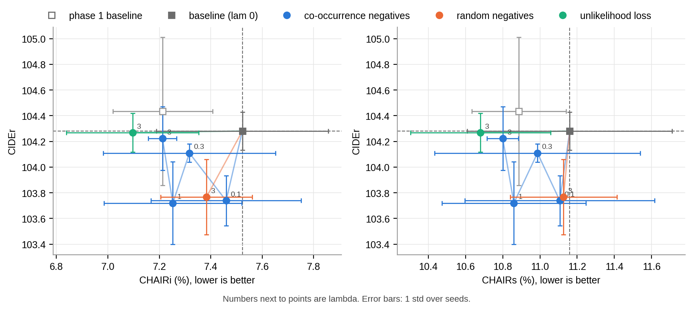
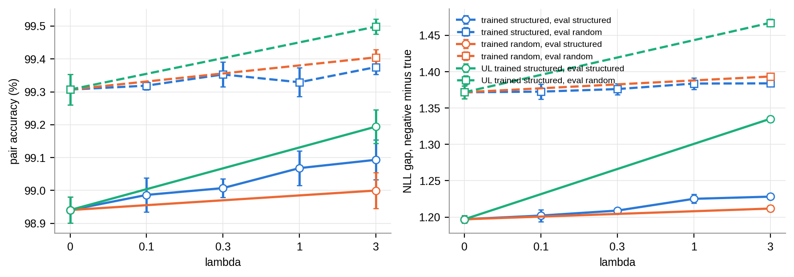
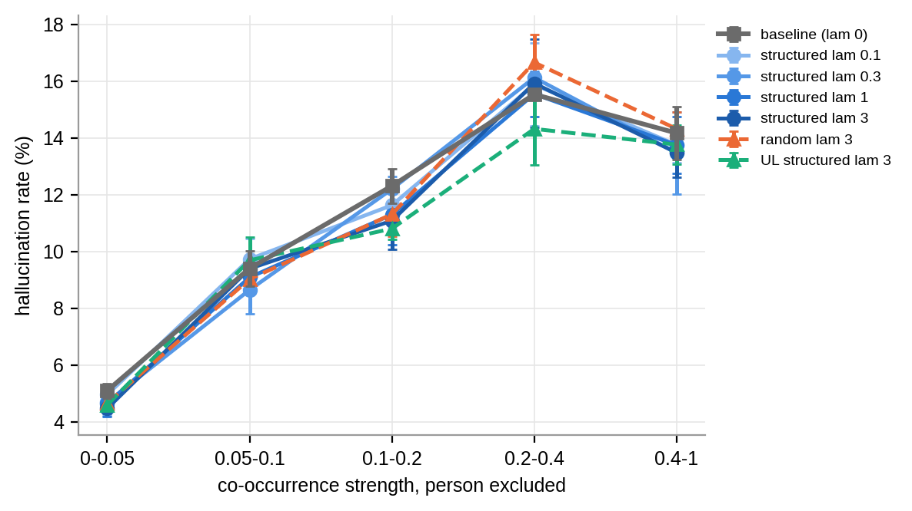
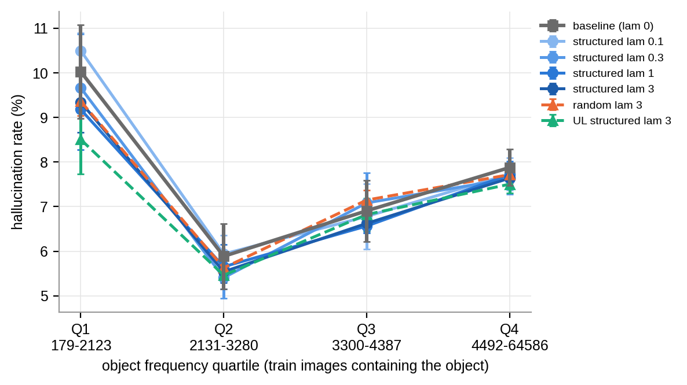
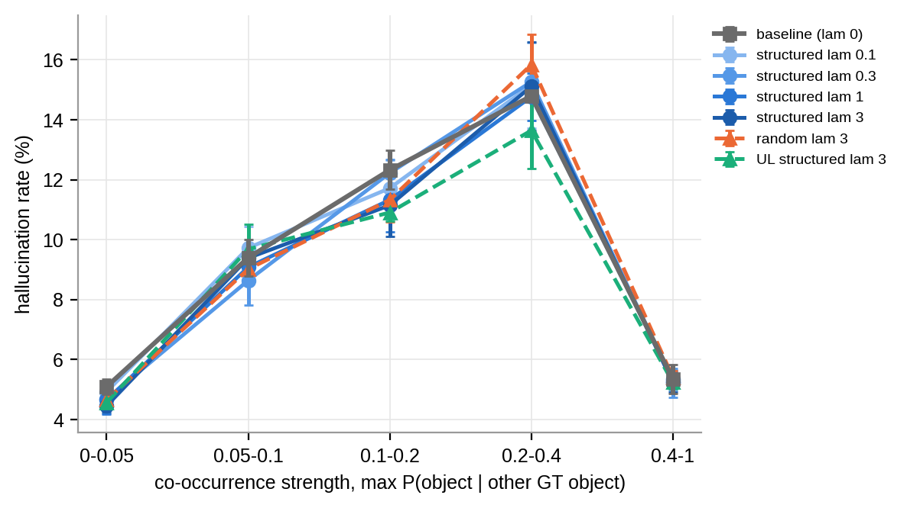

# Do Object-Swap Negatives Reduce Object Hallucination in ClipCap? A Controlled Study of Co-occurrence-Based Negative Training

**SC4001 Neural Networks and Deep Learning — Group Project Report**

**Group:** `TODO: group number`

| Name | Matriculation no. |
|---|---|
| `TODO` | `TODO` |
| `TODO` | `TODO` |
| `TODO` | `TODO` |

<!-- Formatting for the PDF: A4, single column, Arial 10 pt, max 10 pages excluding cover, contents, references and appendix. -->

<div style="page-break-after: always;"></div>

## Contents

1. Introduction
2. Review of Existing Techniques
3. Methods
4. Experimental Setup
5. Results
6. Discussion
7. Conclusion
8. AI Use Statement
References
Appendix

<div style="page-break-after: always;"></div>

## 1. Introduction

Image captioning models are now fluent enough that their mistakes can be hard to notice. One of the most harmful mistakes is **object hallucination**: the caption names an object that is not in the image. Rohrbach et al. [1] showed that hallucination is common in standard COCO captioners and that sentence metrics such as CIDEr do not reliably penalise it. Where people rely on the caption instead of the image, such as alt-text for visually impaired users or downstream systems that index images by their captions, a fluent caption with a non-existent object is worse than a vaguer one that is correct.

A common explanation is that captioners lean on **language priors** learned from object co-occurrence. A model that has often seen "fork" next to "cake" in training captions may mention a fork whenever it sees a cake. Rohrbach et al. [1] relate hallucination to this kind of language consistency, and Li et al. [2] find that large vision–language models are most likely to hallucinate objects that often co-occur with the objects actually in the image. Our baseline shows the same pattern. When we group object mentions by how strongly the other objects in the image predict them in the training data, the hallucination rate on validation rises from 5.1% in the weakest group to 15.5% in the second-strongest (14.2% in the strongest), and the same pattern holds on test (4.3% → 14.8%; Section 5.7).

This suggests a targeted fix. If most errors are objects that co-occur with what is present, we can show the model exactly those errors during training and teach it to reject them. We study this with ClipCap [3], a lightweight captioner that maps a frozen CLIP [4] image embedding to a prefix for a frozen GPT-2 language model [5]. For each training caption we build an **object-swap negative** by replacing one mentioned object with an object that often co-occurs with it but is absent from the image ("A cake sitting on top of a piece of tin foil" → "A fork sitting on top of a piece of tin foil"). An auxiliary loss then asks the model to prefer the true caption over its negative.

**Research question.** Does adding an auxiliary loss on co-occurrence-based object-swap negatives to ClipCap training reduce object hallucination (CHAIR) without hurting caption quality (CIDEr)? And does the co-occurrence structure of the negatives matter, compared with swapping in random objects?

**Contributions.**

- (i) A reproduced ClipCap baseline on the Karpathy split of COCO, trained with three seeds, together with our own CHAIR implementation, a sanity check of CHAIR on human captions, and a paired bootstrap test for comparing models.
- (ii) A negative caption generator that picks replacement objects from a training-set co-occurrence matrix, fixes articles and plurals, and re-checks every negative with CHAIR, plus a random-swap version as a control.
- (iii) Controlled experiments with three seeds per condition and all choices made on validation data: a sweep over the auxiliary loss weight λ, an ablation of co-occurrence against random negatives, and a comparison of a margin ranking loss with an unlikelihood loss.
- (iv) Diagnostics that explain why there is no measurable effect (the negatives are already easy and the margin loss saturates).
- (v) Breakdowns of hallucination by object frequency and co-occurrence strength.

**Summary of findings.** The effects are small and mostly not significant, and we report them as such. On validation, the margin loss lowers CHAIRi steadily as λ grows (−0.06, −0.21, −0.27, −0.31 points at λ = 0.1, 0.3, 1, 3 against the λ = 0 control) while CIDEr is unchanged (−0.06 at λ = 3), but no step is significant (best p = 0.067). The **unlikelihood loss hallucinates least on validation**: CHAIRi falls from 7.52% to 7.10% (−0.43 points, about 6% relative) with no loss in CIDEr (−0.01), p = 0.018. This is the only significant difference, and it does not survive a Bonferroni correction for six comparisons. On validation, **co-occurrence negatives beat random ones** (−0.31 vs −0.14 CHAIRi at λ = 3, and random negatives cost 0.5 CIDEr), but the direct difference is not significant. No condition shortened captions or lowered object recall, so the CHAIR drops do not come from vaguer captions. The diagnostics give a clear reason why the effect is at best small: even at λ = 0 the model already prefers the true caption over its negative in 98.9% of validation pairs, with a mean NLL gap of 1.2 against a margin of 0.2, so the hinge loss is zero for most pairs and gives almost no gradient. Single-object swaps are too easy for a CLIP-conditioned captioner, even though co-occurrence is clearly where its hallucinations come from. **On the held-out test split none of the validation gains replicate**: against the λ = 0 control, structured margin is +0.05 CHAIRi, unlikelihood +0.11 and random −0.19, all far from significant (p ≥ 0.29) and smaller than the 0.75-point spread between the control's own seeds. The co-occurrence pattern in hallucinations does replicate on test (4.3% → 14.8%).

**Roadmap.** Section 2 reviews prior work on captioning, hallucination metrics and negative training. Section 3 describes the baseline, the negative generator and the losses, and Section 4 the experimental setup. Section 5 presents the results and diagnostics, Section 6 discusses failure cases and limitations, and Section 7 concludes.

## 2. Review of Existing Techniques

### 2.1 Image captioning with pretrained vision and language models

Early neural captioners used an encoder–decoder design: a CNN encodes the image and an RNN (usually an LSTM) generates the caption word by word [12]. Visual attention let the decoder look at different image regions at each step [13], and attention over detected object regions (bottom-up features) became the standard for COCO [14]. Transformer captioners then replaced the recurrent decoder [15]. All of these are trained from scratch on caption data, so the decoder's language model learns its priors only from about 0.5M COCO captions.

CLIP [4] trains an image encoder and a text encoder contrastively on 400M image–text pairs, so that matching pairs have similar embeddings. Its image embeddings carry rich semantic information and transfer well to new tasks.

**ClipCap** [3] combines a frozen CLIP image encoder with a pretrained GPT-2 language model [5]. A mapping network turns the CLIP embedding into a fixed-length *prefix* of GPT-2 input embeddings, and GPT-2 generates the caption after this prefix. The paper offers two variants: an MLP mapping network with GPT-2 fine-tuned, and a transformer mapping network with GPT-2 frozen, where only the mapping network is trained. The frozen variant is a good baseline for our compute budget: CLIP features can be extracted once, training touches only the mapping network, and a run of 10 epochs fits in a few GPU hours. It also gives a clean setting for our question, because the language prior lives entirely in the frozen GPT-2 and can only be steered through the prefix.

### 2.2 Object hallucination and how it is measured

**CHAIR** (Caption Hallucination Assessment with Image Relevance) [1] measures hallucination over the 80 COCO object categories. Each caption is parsed into object mentions using a synonym list that maps surface words (e.g. "puppy", "pup") to categories, and each mention is checked against the image's ground-truth objects, taken from the segmentation annotations and the human captions. Two scores are reported:

$$\text{CHAIR}_i = \frac{|\{\text{hallucinated object mentions}\}|}{|\{\text{all object mentions}\}|}, \qquad \text{CHAIR}_s = \frac{|\{\text{captions with} \geq 1 \text{ hallucinated object}\}|}{|\{\text{all captions}\}|}$$

Rohrbach et al. also show that models with lower hallucination are not always ranked higher by sentence metrics, and they analyse whether errors follow the language model ("language consistency") or the image ("image consistency"), finding that "models which hallucinate more tend to make mistakes consistent with a language model". They name "over-reliance on language priors" as one of the main causes of hallucination.

**POPE** [2] measures hallucination in large vision–language models by asking yes/no questions ("Is there a fork in the image?") about present objects and about absent objects sampled at random, by frequency, or by co-occurrence (adversarial). Its main finding, that hallucinated objects tend to be frequent or co-occurring ones, motivates our negatives. POPE needs a model that can answer questions, while ClipCap only generates captions. CHAIR scores the captions the model actually produces, so it fits our setting better.

**Caption quality.** BLEU [9] counts n-gram precision, METEOR [10] aligns words with stemming and synonyms, and CIDEr [8] weights n-grams by TF-IDF across the reference set, so it rewards content words that the human captions agree on. CIDEr was designed for image description and is the main metric in captioning work, so we use it as our main quality metric and report BLEU-4 and METEOR alongside.

### 2.3 Negative and contrastive training for language generation

Hard negatives are widely used in vision–language learning. VSE++ [23] trains image–text embeddings with a hinge-based ranking loss that focuses on the hardest negative in each batch. In compositionality work, captions with swapped or replaced words act as hard negatives: NegCLIP [16] adds word-order-swapped captions to CLIP fine-tuning, and SugarCrepe [17] builds replace/swap/add negatives for objects, attributes and relations to test whether models notice the change. These works aim at image–text *matching*. We use the same idea of a minimally edited negative caption, but inside a *generative* captioner.

**Unlikelihood training** [11] adds a term $-\log(1 - p(c \mid \text{context}))$ for unwanted tokens $c$, directly pushing their probability down. Welleck et al. use it to reduce repetition in text generation. We use it as a token-level alternative to a sequence-level margin.

For hallucination in captioning specifically, Biten et al. [18] name the systematic co-occurrence of object categories as the main cause of object bias. They replace objects in (simplified) training captions with sampling designed to make the co-occurrence statistics more uniform, and also feed object-label embeddings to the model. Dai et al. [19] probe object hallucination in vision–language pre-training and propose an object-masked language modelling loss (ObjMLM) to reduce it. Both change the training data or the pre-training objective. We instead keep the data and add negatives to the loss.

**Gap.** These methods either change the training data, change pre-training, or target large models. We found few studies that test cheap, co-occurrence-targeted negative captions as an auxiliary loss on a lightweight prefix captioner, with multiple seeds and an ablation against random negatives. This is the gap we address.

## 3. Methods

### 3.1 Baseline: ClipCap

```
                       frozen                    trained                         frozen
 image ──► CLIP RN50x4 image encoder ──► 640-d ──► transformer mapping ──► prefix (40 × 768) ──► GPT-2 ──► caption
                                                  network (8 layers)                             │
                                                                                                  ├─► L_NLL(c+)            (caption loss)
                                         same prefix, teacher-forced on c+ and on c− ────────────┴─► L_aux(c+, c−)        (margin or unlikelihood)
```
*Figure 1: Model and training losses. `TODO: redraw as a proper figure for the PDF.` Gradients from both losses reach only the mapping network.*

- **Image encoder.** Frozen CLIP RN50x4, giving a 640-d embedding per image. Our original plan used ViT-B/32, which is the default in the ClipCap code. We switched because ClipCap's released COCO transformer checkpoint takes 640-d input, which matches RN50x4 (ViT-B/32 gives 512-d), so with RN50x4 we can compare our baseline directly with that checkpoint (Section 5.1). The ClipCap paper does not name the backbone it used. Features are extracted once for all images and stored.
- **Mapping network.** The ClipCap transformer mapping network (8 layers) with prefix length 40. GPT-2 (124M, `gpt2` from Hugging Face) is frozen, so only the mapping network is trained.
- **Training objective.** Standard caption cross-entropy with teacher forcing, $L_{\text{NLL}}$, the mean negative log-likelihood over caption tokens.
- **Decoding.** Greedy, at most 30 tokens, stopping at the first full stop. This is the same for every condition, so differences cannot come from decoding.

Code: `phase_1/track_2/track_2.py`, `phase_1/track_2/tc1/train_baseline.py`.

### 3.2 Object-swap negative generation

**Object vocabulary.** The 80 COCO categories and their 403 surface words from the CHAIR synonym list [1].

**Co-occurrence matrix.** $M_{o,g}$ is the number of training images containing both objects $o$ and $g$, so $M_{o,o}$ is the number of images containing $o$. We build $M$ from the CHAIR ground truth of each training image (objects from the segmentation annotations plus objects mentioned in its captions), not from instance annotations alone. This is a small deviation from our plan. This means "present" has the same meaning in the negatives and in the evaluation.

**Structured swap.** For a caption $c^+$ of an image with ground-truth objects $G$:

```
1. Find the object mentions in c+ by matching the CHAIR synonym words (and their
   plurals); visit them in random order.
2. For the current mention o: candidates = objects not in G, ranked by M[o, ·];
   shuffle the top 10 and try them in that order (then the rest).
3. Replace the mention's words with the candidate word, fixing "a"/"an",
   capitalisation, and plural form to match the original.
4. Re-run CHAIR extraction on the new caption c−; accept only if the new object
   is detected (this catches cases such as "teddy" + "bear").
5. If no candidate works, move to the next mention; if none works, c+ has no negative.
```

**Random swap (control).** The same procedure, but the candidates are all absent objects in random order, so the replacement is drawn uniformly from absent objects.

**No single-token rule.** Our original plan restricted replacements to objects that are a single GPT-2 token. As a team we dropped this rule: the margin loss compares whole captions and the unlikelihood loss covers all swapped tokens, so multi-token objects ("baseball bat", "hot dog") work without special handling.

**Coverage and quality.** 89.9% of training and 89.8% of validation captions receive a negative; the rest have no swappable object mention. An automated spot check of 100 negatives of each type found 2% ungrammatical structured negatives, and 2% ungrammatical plus 5% plural errors in random negatives, with no negatives whose new object was present in the image or missed by CHAIR. We then reviewed a separate sample of 200 negatives (100 per type) by hand (`manual_review_negatives.csv`). We marked a negative as an error if it was ungrammatical, had the wrong number, or replaced a word that was not used as an object (Table 1). We also marked whether each negative describes a scene that could plausibly occur (the swap is wrong for this image but not absurd). Table 1b shows examples.

*Table 1: Manual review of 100 negatives per type (a different sample from the automated check).*

| | Structured | Random |
|---|---|---|
| Errors (total) | **8%** | **9%** |
| – wrong number ("two person", "a carrots lies") | 4 | 3 |
| – word not used as an object ("orange color scheme", "passenger bus", "remote control") | 3 | 2 |
| – other grammar ("a scissors", "broccolis", capitalisation) | 1 | 4 |
| Plausible scenes | 30% | 20% |
| Plausible when source is not "person" | 29 / 76 (38%) | 19 / 72 (26%) |
| Source object is "person" | 24% | 28% |

The manual error rate (8–9%) is higher than the automated check (2–7%). The automated grammar check misses two kinds of error. First, the `inflect` library misreads some singular nouns as plural ("bus" → "bu", "sheep", "aircraft"), which gives "a carrots lies". Second, the parser counts colour words and modifiers as objects ("an orange plate" → "a bottle plate").

*Table 1b: Example negatives (from `out/results/manual_review_negatives.csv`).*

| Type | Original | Negative |
|---|---|---|
| Structured | A cake sitting on top of a piece of tin foil. | A **fork** sitting on top of a piece of tin foil. |
| Structured | A young boy holding a baseball bat getting ready to swing at the ball. | A young boy holding a **backpack** getting ready to swing at the ball. |
| Structured | an elephant is standing over near a tree | a **chair** is standing over near a tree |
| Random | A giraffe stands in front of a ladder attached to a building | A **toaster** stands in front of a ladder attached to a building |
| Random | A sheep lies in the shade with a dog in a yard | A **carrots** lies in the shade with a dog in a yard *(plural error)* |

Structured negatives replace an object with one that fits the scene (cake → fork), while random negatives are often absurd (giraffe → toaster). This is intended: structured negatives should be harder to reject. The review confirms the difference but shows it is smaller than we hoped. Only 30% of structured negatives are plausible scenes, against 20% of random ones. The main reason is "person": it is the most common source object, and the top co-occurring objects for "person" are things a person uses (dining table, bottle, chair, backpack), not alternatives to a person. So "A man is using his laptop" becomes "A cup is using his laptop", which is as absurd as a random swap. Only 1 of the 24 structured swaps from "person" was plausible.

Code: `phase_2/track_1_and_3/object_swap.py` (`build_cooccurrence_matrix`, `generate_swap`).

### 3.3 Auxiliary loss

The total loss for a batch is

$$L = L_{\text{NLL}}(c^+) + \lambda \cdot L_{\text{aux}}(c^+, c^-),$$

where positives and negatives share one pass through the mapping network and one GPT-2 forward pass. With $\lambda = 0$ the loss is exactly the baseline loss.

**Margin loss (default).** Let $\overline{\text{NLL}}(c)$ be the mean per-token NLL of caption $c$ given the image prefix. Then

$$L_{\text{aux}}^{\text{margin}} = \frac{1}{|P|}\sum_{(c^+, c^-) \in P} \max\left(0,\; m + \overline{\text{NLL}}(c^+) - \overline{\text{NLL}}(c^-)\right), \qquad m = 0.2,$$

averaged over the set $P$ of captions in the batch that have a negative. This is a **sequence-level** comparison. Our original plan compared $\log p(\text{true word})$ with $\log p(\text{swapped word})$ at the swap position. We changed this because the sequence-level form is simpler, needs no alignment between the two captions, and handles multi-token objects and article changes ("a" → "an") without special cases.

**Unlikelihood loss (variant).** Let $S$ be the swapped span of each negative: the tokens of $c^-$ after the longest common prefix and before the longest common suffix with $c^+$. Then

$$L_{\text{aux}}^{\text{UL}} = -\frac{1}{|S|}\sum_{t \in S} \log\left(1 - p(c^-_t \mid c^-_{<t}, \text{image})\right),$$

where $S$ here is the union of the swapped spans over all negatives in the batch, so the mean is taken over swapped tokens, not per negative.

This only pushes down the probability of the swapped object, which is closer to the per-word comparison in our plan [11]. Unlike the hinge, it never becomes exactly zero.

In both cases gradients reach only the mapping network, because CLIP and GPT-2 are frozen.

**Smoke test.** On the pretrained ClipCap checkpoint with a toy batch, the NLL term equals the baseline caption loss exactly (2.2626), the positive NLL is lower than the negative NLL (2.21 vs 3.32), pair accuracy is 100%, gradients reach the mapping network, and a batch with no negatives gives a finite loss equal to the caption loss (`out/results/loss_smoke_test.json`).

Code: `object_swap.py` (`object_swap_loss`, `swap_span_mask`).

### 3.4 Our contribution versus existing code

- **Existing code and models we used:** the ClipCap repository and model class [3]; pretrained CLIP RN50x4 [4] and GPT-2 [5] weights; `pycocoevalcap` for BLEU, METEOR and CIDEr; the CHAIR synonym list from Rohrbach et al. [1]; the Karpathy split [7].
- **Our own work:** a CHAIR re-implementation with 15 unit tests; the feature extraction pipeline; the co-occurrence matrix and negative generator with grammar fixes and CHAIR re-checks; both auxiliary losses and their smoke test; a multi-seed training harness with checkpoint resume across Colab and the TC1 cluster; the swap-accuracy diagnostics; the paired bootstrap; and the frequency and co-occurrence breakdowns.

## 4. Experimental Setup

**Dataset.** MS-COCO 2014 [6] with the Karpathy split [7]: 113,287 training, 5,000 validation and 5,000 test images, with about five captions each (about 567k training captions).

**Keeping test data separate.** All tuning and selection (mapping network, λ, loss type) used validation data only. The test split is evaluated once, after the code freeze, for the four final configurations. The test notebook (`phase_3/test_eval/phase3_test_eval.ipynb`) refuses to run on test unless `CONFIRM_TEST = True` is set, as a guard against accidental test runs. Before the test run we checked the notebook on validation: it reproduced the Phase 2 captions for 99.98% of images (the remaining one image differs, most likely from GPU rounding between a V100 and a T4) and gave identical CHAIRi and CHAIRs and the same CIDEr to two decimals (104.47). The test run then decoded all 12 final runs (4 conditions × 3 seeds) on a Colab T4.

**Metrics.** BLEU-4, METEOR and CIDEr from `pycocoevalcap`; CHAIRi and CHAIRs from our implementation (15/15 unit tests). We also report average caption length and **object recall** (the share of an image's ground-truth objects that its caption mentions, averaged over images). These catch a model that games CHAIR by writing shorter or vaguer captions, which mention fewer objects and so have fewer chances to hallucinate.

**CHAIR sanity check.** A ground-truth caption scored against its own image's annotations gives CHAIRi = CHAIRs = 0. Scoring each human caption against the ground truth built from the *other* captions (leave-one-out) gives CHAIRi 2.56% and CHAIRs 3.63%. This is not zero because annotators disagree about which objects are present. It gives a floor for what "low" means: our models score about 7.1–7.5% CHAIRi, so human captions already score about a third of the model's CHAIRi.

**Training.** 10 epochs, AdamW [20] with learning rate 2e-5, 5,000 linear warm-up steps followed by linear decay, batch size 40, fp16 mixed precision. Apart from fp16, which we added for speed, these are the ClipCap defaults. Baseline runs started on Colab T4 GPUs and resumed from checkpoints on TC1 V100s; all Phase 2 runs used TC1 V100s. A baseline run took 3.5–5.4 GPU hours and an auxiliary-loss run about 5.4 hours (both caption sets go through GPT-2). In total we logged about 105 GPU hours, plus four runs whose time was not logged. Every condition was trained with seeds 0, 1 and 2.

**Experiments.**

1. **Mapping-network sweep (D1).** 3 epochs, seed 0: transformer × prefix 10/40 and MLP × prefix 10, chosen by val CIDEr. MLP with prefix 40 was skipped: its output layer grows with prefix length, giving about 480M parameters, which was too slow to train in our time.
2. **λ sweep.** Structured negatives with the margin loss, λ ∈ {0, 0.1, 0.3, 1, 3} × 3 seeds (15 runs).
3. **Ablation.** Random negatives at the selected λ (3 runs).
4. **Loss comparison.** Unlikelihood loss with structured negatives at the selected λ (3 runs).

**Selection rule.** Agreed by the team before the sweep finished: pick the λ > 0 with the lowest mean val CHAIRi among those whose mean val CIDEr is no more than 2 points below the Phase 1 baseline (104.43, so a floor of 102.43). The rule gives the same choice against the λ = 0 control. All four λ values passed the CIDEr check and **λ = 3** had the lowest CHAIRi (`out/results/best_lambda.json`). λ = 3 is the edge of our grid.

**Reference model.** The control for every comparison is the **λ = 0 run** of the Phase 2 code, not the Phase 1 baseline. Both have the same setup and, with λ = 0, the same loss (the Phase 2 code then drops the negatives and uses the baseline batching and caption loss). We use the λ = 0 run because it was trained with the same code, on the same GPUs (TC1 V100s) and in the same batch of jobs as the other conditions.

**Statistics.** We report mean ± standard deviation over the three seeds (population std, in every table). To test a CHAIR difference we use a **paired bootstrap over images** [21, 22], computed in the analysis notebook (`phase_2/track_2/phase2_track2.ipynb` for val, `phase_3/phase3_analysis/phase3_analysis.ipynb` for test): each of 2,000 draws resamples the 5,000 images with replacement, scores both models on the same draw, and averages over seeds, comparing condition seed *s* with control seed *s*. The 95% CI is the 2.5th–97.5th percentile of the difference, and the two-sided *p* is twice the smaller tail. We make six comparisons against the control (four λ values, random, unlikelihood), so the Bonferroni threshold is 0.05/6 = 0.0083. This bootstrap captures variation from which images are in the split, **not** variation between training seeds (Section 6.3).

## 5. Results

### 5.1 Baseline reproduction

*Table 2: Mapping-network sweep (val, 3 epochs, seed 0).*

| Mapping | Prefix | CIDEr | CHAIRi (%) | CHAIRs (%) | Train hours |
|---|---|---|---|---|---|
| **Transformer** | **40** | **103.9** | 8.11 | 12.46 | 2.8 |
| Transformer | 10 | 101.5 | 7.90 | 11.98 | 1.6 |
| MLP | 10 | 90.1 | 7.50 | 11.56 | 1.3 |
| MLP | 40 | — skipped (≈480M parameters) | | | |

The transformer with prefix 40 had the best CIDEr and was chosen. The MLP has the lowest CHAIR, but it writes worse captions overall (CIDEr −14) and mentions fewer of the true objects (object recall 52.9% vs 55.4%), so its lower CHAIR does not mean a better model.

*Table 3: Final baseline (val, 10 epochs, mean ± std over 3 seeds) and the pretrained ClipCap checkpoint, both with greedy decoding.*

| Model | BLEU-4 | METEOR | CIDEr | CHAIRi (%) | CHAIRs (%) | Length | Obj. recall (%) |
|---|---|---|---|---|---|---|---|
| Our baseline (Phase 1) | 31.14 ± 0.21 | 26.47 ± 0.07 | 104.43 ± 0.58 | 7.21 ± 0.19 | 10.89 ± 0.25 | 9.79 | 55.1 |
| Pretrained ClipCap checkpoint | 31.43 | 26.22 | 104.06 | 7.63 | 11.16 | 9.56 | 55.2 |

Our trained baseline matches the released checkpoint under the same greedy decoding (CIDEr 104.4 vs 104.1), so the reproduction is sound. The ClipCap paper reports BLEU-4 33.53, METEOR 27.45 and CIDEr 113.08 for the frozen-GPT-2 transformer variant on the Karpathy test split [3]. The paper says captions are produced "by employing a greedy approach or beam search" but does not say which one gives its table. Because the released checkpoint reaches only 104.1 with our greedy decoder, the 9-point gap most likely comes from the decoding method and not from our training. Our numbers are also on val, not test.

Validation loss falls until epoch 6 (2.277–2.279 for the three seeds) and then rises slightly to 2.31–2.32 at epoch 10, while training loss keeps falling. We kept the 10-epoch schedule of the ClipCap defaults for all conditions so that the comparisons stay controlled.

### 5.2 Main results on the test split

*Table 4: Final configurations on the Karpathy **test** split (5,000 images, mean ± std over 3 seeds). Δ and p are from the same paired bootstrap as Table 6, run on the test images. Source: `phase_3/test_eval/tables/runs_test.csv`, `phase_2/track_2/test/tables/results_table.csv`, `phase_2/track_2/test/tables/bootstrap.csv`.*

| Condition | BLEU-4 | METEOR | CIDEr | CHAIRi (%) | CHAIRs (%) | Length | Obj. recall (%) | Δ CHAIRi vs λ=0 [95% CI] | p |
|---|---|---|---|---|---|---|---|---|---|
| Control (λ = 0) | 30.88 ± 0.24 | 26.45 ± 0.07 | 104.73 ± 0.39 | 6.80 ± 0.32 | 10.22 ± 0.49 | 9.81 | 56.02 | — | — |
| Structured, margin, λ = 3 | 30.69 ± 0.38 | 26.39 ± 0.10 | 104.52 ± 0.81 | 6.85 ± 0.22 | 10.23 ± 0.33 | 9.83 | 55.88 | +0.05 [−0.32, +0.41] | 0.789 |
| Random, margin, λ = 3 | 30.91 ± 0.48 | 26.50 ± 0.15 | 105.09 ± 1.07 | 6.62 ± 0.23 | 10.01 ± 0.35 | 9.79 | 55.86 | −0.19 [−0.52, +0.14] | 0.296 |
| Structured, unlikelihood, λ = 3 | 30.97 ± 0.19 | 26.36 ± 0.09 | 105.02 ± 0.35 | 6.92 ± 0.10 | 10.42 ± 0.07 | 9.78 | 55.86 | +0.11 [−0.24, +0.46] | 0.540 |


*Figure 2: CHAIR vs CIDEr on the **test** split for the four final configurations (mean over 3 seeds, error bars 1 std; the dashed lines and grey square mark the λ = 0 control, labelled "baseline (lam 0)" in the legend; "co-occurrence negatives" is the structured margin condition; thin lines join each condition to the control). Every condition's error bars overlap the control on both axes.*

**The validation results do not replicate on test** (Table 4, Figure 2). (1) The unlikelihood drop is gone: CHAIRi is 0.11 points *higher* than the control (p = 0.54), against −0.43 on validation. The validation p = 0.018 did not survive Bonferroni correction, so a nominally significant result that does not replicate is unsurprising; the test result is consistent with no real effect. (2) The ablation reverses: random negatives now have the lowest CHAIRi (−0.19 vs the control, p = 0.30), and random vs structured is −0.23 (p = 0.20). Random also has the highest CIDEr (105.09 vs 104.52 for structured) and METEOR, so the validation ordering of structured over random reverses on CHAIRi, CHAIRs and CIDEr. Neither CHAIR difference is significant, so the test split gives no support for co-occurrence negatives being better than random ones. Structured margin at λ = 3 is +0.05 (p = 0.79), and the direct unlikelihood vs margin difference is +0.07 (p = 0.72). (3) CIDEr stays flat: all conditions are within 0.4 points of the control (104.5–105.1), and length (9.78–9.83) and object recall (55.9–56.0%) do not move. The CHAIRs results follow the same pattern (Δ −0.21 to +0.20, all p ≥ 0.43). The size of the noise is clear from the control alone: its three seeds give 7.12%, 6.37% and 6.92% CHAIRi, a 0.75-point range that is larger than any difference between conditions. Matched by seed, every condition changes sign across the three seeds (e.g. unlikelihood −0.29, +0.50, +0.14). Test CHAIR is lower than validation CHAIR for every condition (6.6–6.9% vs 7.1–7.5%), so the two splits differ in difficulty, but the comparisons between conditions are on the same images.

The rest of this section uses validation results, which drove all selection and analysis.

### 5.3 λ sweep (validation)

*Table 5: Validation results, mean ± std over 3 seeds. Δ columns are matched by seed against the λ = 0 control (negative = fewer hallucinations).*

| Condition | BLEU-4 | METEOR | CIDEr | CHAIRi (%) | CHAIRs (%) | Length | Obj. recall (%) | Δ CIDEr | Δ CHAIRi | Δ CHAIRs |
|---|---|---|---|---|---|---|---|---|---|---|
| Phase 1 baseline | 31.14 ± 0.21 | 26.47 ± 0.07 | 104.43 ± 0.58 | 7.21 ± 0.19 | 10.89 ± 0.25 | 9.79 | 55.07 | +0.15 | −0.31 | −0.27 |
| **Control, λ = 0** | 30.96 ± 0.10 | 26.53 ± 0.02 | 104.28 ± 0.15 | 7.52 ± 0.33 | 11.16 ± 0.55 | 9.81 | 55.23 | — | — | — |
| Structured, λ = 0.1 | 30.75 ± 0.27 | 26.39 ± 0.04 | 103.74 ± 0.19 | 7.46 ± 0.29 | 11.11 ± 0.51 | 9.82 | 55.09 | −0.54 | −0.06 | −0.05 |
| Structured, λ = 0.3 | 30.94 ± 0.14 | 26.51 ± 0.01 | 104.11 ± 0.07 | 7.32 ± 0.34 | 10.99 ± 0.55 | 9.85 | 55.30 | −0.17 | −0.21 | −0.17 |
| Structured, λ = 1 | 30.81 ± 0.21 | 26.38 ± 0.05 | 103.72 ± 0.32 | 7.25 ± 0.27 | 10.86 ± 0.39 | 9.77 | 55.30 | −0.56 | −0.27 | −0.30 |
| **Structured, λ = 3** (selected) | 30.83 ± 0.09 | 26.44 ± 0.13 | 104.22 ± 0.25 | 7.21 ± 0.06 | 10.80 ± 0.08 | 9.82 | 55.28 | −0.06 | −0.31 | −0.36 |
| Random, λ = 3 | 30.85 ± 0.11 | 26.42 ± 0.03 | 103.77 ± 0.29 | 7.38 ± 0.18 | 11.13 ± 0.29 | 9.81 | 55.35 | −0.51 | −0.14 | −0.03 |
| **Unlikelihood, λ = 3** | 30.98 ± 0.04 | 26.48 ± 0.05 | 104.27 ± 0.15 | **7.10 ± 0.26** | **10.68 ± 0.38** | 9.78 | 55.17 | −0.01 | **−0.43** | **−0.48** |

*Table 6: Paired bootstrap of CHAIR differences (val, 3 seeds, 2,000 draws). Bonferroni threshold for the six comparisons against the control: p < 0.0083.*

| Comparison | Δ CHAIRi | 95% CI | p | Δ CHAIRs | 95% CI | p |
|---|---|---|---|---|---|---|
| Structured λ = 0.1 vs control | −0.06 | [−0.41, +0.28] | 0.721 | −0.05 | [−0.59, +0.47] | 0.844 |
| Structured λ = 0.3 vs control | −0.21 | [−0.55, +0.13] | 0.230 | −0.17 | [−0.71, +0.32] | 0.506 |
| Structured λ = 1 vs control | −0.27 | [−0.62, +0.06] | 0.106 | −0.30 | [−0.82, +0.21] | 0.260 |
| Structured λ = 3 vs control | −0.31 | [−0.65, +0.03] | 0.067 | −0.36 | [−0.87, +0.13] | 0.159 |
| Random λ = 3 vs control | −0.14 | [−0.51, +0.22] | 0.433 | −0.03 | [−0.63, +0.49] | 0.885 |
| Unlikelihood λ = 3 vs control | **−0.43** | **[−0.76, −0.08]** | **0.018** | −0.48 | [−1.01, +0.06] | 0.077 |
| Random vs structured, λ = 3 | +0.17 | [−0.21, +0.52] | 0.353 | +0.33 | [−0.25, +0.85] | 0.231 |
| Unlikelihood vs margin, λ = 3 | −0.12 | [−0.45, +0.23] | 0.506 | −0.12 | [−0.65, +0.41] | 0.669 |


*Figure 3: CHAIRi (left) and CHAIRs (right) vs CIDEr on validation for every condition (mean over 3 seeds, error bars 1 std). Points are labelled by λ; the structured margin sweep ("co-occurrence negatives") is joined in order of λ starting from the λ = 0 control (filled square), and the random and unlikelihood points are joined directly to the control. The hollow square is the Phase 1 baseline. Good conditions move left without moving down. The seed spread (error bars) is as wide as the distance between conditions.*

With the margin loss, CHAIRi falls steadily as λ grows (Figure 3), from 7.52% at λ = 0 to 7.21% at λ = 3, and CHAIRs follows (11.16% → 10.80%). CIDEr stays within 0.6 points of the control throughout and is essentially unchanged at λ = 3 (−0.06). Length and object recall do not move (9.77–9.85 words, 55.1–55.3% recall), so the lower CHAIR does not come from shorter or vaguer captions. λ = 3 also has the smallest seed spread of any condition (CHAIRi std 0.06).

But none of these differences is significant. The best margin result, λ = 3, has p = 0.067 and its CI just includes zero. The trend is consistent in direction, which is some evidence of a real but small effect, but each step is smaller than the noise.

The Phase 1 baseline and the λ = 0 control show how large that noise is. They are the same model, trained with the same seeds and hyperparameters, yet differ by 0.31 CHAIRi points (p = 0.051), as much as the margin loss at λ = 3. We have not pinned down the cause. The likely source is numerical non-determinism: fp16 training, and Phase 1 runs moving between T4 and V100 GPUs while all λ = 0 runs used V100s. The lesson is that run-to-run variation is as large as our effects.

λ = 3 is the edge of our grid. The validation trend had not flattened, so a larger λ might have helped further; we did not test this, to stay within compute. Given that λ = 3 shows no gain on test (+0.05 CHAIRi), we would not expect much from it.

### 5.4 Ablation: structured vs random negatives

Random negatives at λ = 3 give CHAIRi 7.38 ± 0.18% (−0.14 against the control) and CHAIRs 11.13 ± 0.29% (−0.03), against 7.21% and 10.80% for structured negatives. They also cost more caption quality (CIDEr −0.51 vs −0.06). Structured negatives are better on CHAIRi, CHAIRs and CIDEr (random is ahead only by 0.02 BLEU-4 and 0.07 recall points), which fits the hypothesis that co-occurrence structure is what matters. However, the direct comparison (random vs structured, +0.17 CHAIRi, p = 0.35) is not significant, so this is directional support only, and on test the order reverses (random −0.23 vs structured, p = 0.20; Section 5.2).

The swap statistics confirm that structured negatives are the harder ones, as designed. At λ = 0, the model's NLL gap between negative and true caption is 1.20 for structured negatives against 1.37 for random ones, and pair accuracy is 98.9% against 99.3% (Table 7). A plausible swap (cake → fork) is less surprising to the model than an absurd one (giraffe → toaster).

### 5.5 Margin vs unlikelihood loss

On validation, the unlikelihood loss at λ = 3 gives the lowest hallucination of any condition: CHAIRi 7.10 ± 0.26% and CHAIRs 10.68 ± 0.38%, with CIDEr unchanged (104.27, −0.01). Its CHAIRi drop of 0.43 points (about 6% relative) is the only significant result (95% CI [−0.76, −0.08], p = 0.018). It is not significant after correcting for six comparisons (threshold 0.0083), and its CHAIRs drop is not significant (p = 0.077). Compared directly with the margin loss at λ = 3, the difference is −0.12 CHAIRi and not significant (p = 0.51). We treated it as a promising result for the test split to confirm. It did not: on test the unlikelihood model is 0.11 points *above* the control (Section 5.2).

The per-seed picture shows why caution is needed. Matched by seed, the unlikelihood CHAIRi changes are −0.75 (seed 0), −0.68 (seed 1) and +0.15 (seed 2) points. Seed 2 goes the other way for every condition at λ ≥ 1 (margin λ = 1: +0.13, margin λ = 3: +0.15, random: +0.23), partly because the seed-2 control has the lowest CHAIRi of the three (7.13% vs 7.49% and 7.95%). The pooled result depends on two of three seeds.

The unlikelihood loss also separates true and swapped captions more strongly. It widens the structured NLL gap to 1.34, against 1.23 for the margin loss at λ = 3 and 1.20 at λ = 0, and raises pair accuracy to 99.2% (Table 7).

### 5.6 Diagnostics: why the auxiliary loss has little effect

*Table 7: Swap statistics on validation pairs (mean over 3 seeds; std ≤ 0.06 points for accuracy and ≤ 0.01 for the gap). Gap = mean NLL(negative) − NLL(true).*

| Condition | Pair acc., structured (%) | Gap, structured | Pair acc., random (%) | Gap, random |
|---|---|---|---|---|
| Control, λ = 0 | 98.94 | 1.197 | 99.31 | 1.372 |
| Structured, λ = 0.1 | 98.99 | 1.202 | 99.32 | 1.373 |
| Structured, λ = 0.3 | 99.01 | 1.209 | 99.35 | 1.376 |
| Structured, λ = 1 | 99.07 | 1.225 | 99.33 | 1.384 |
| Structured, λ = 3 | 99.09 | 1.228 | 99.38 | 1.384 |
| Random, λ = 3 | 99.00 | 1.212 | 99.40 | 1.393 |
| Unlikelihood, λ = 3 | 99.19 | 1.335 | 99.50 | 1.467 |


*Figure 4: Pair accuracy (left) and NLL gap (right) on validation negatives, by λ (mean over 3 seeds, error bars 1 std). Solid lines: scored on structured negatives; dashed: on random negatives. Colours give the training condition; random and unlikelihood were only trained at λ = 3, so their lines join λ = 0 to λ = 3 directly. Pair accuracy starts at 98.9% before any auxiliary training.*

The key observation is in the first row. **Without any auxiliary loss**, the baseline already prefers the true caption over the structured negative in 98.9% of validation pairs, and the mean NLL gap (1.20) is six times the margin (0.2). The hinge $\max(0, m + \text{NLL}^+ - \text{NLL}^-)$ is therefore zero for almost every pair: the mean validation hinge at λ = 0 is only 0.006. The margin loss has almost nothing to train on.

Training logs show the same thing. At step 500, the training ranking loss is about 0.10 and pair accuracy about 0.78–0.82, because the mapping network is still untrained. By step 14,500 (about one epoch) pair accuracy on training batches is 0.99, and by the end of training the ranking loss is 0.0001 at λ = 3 (0.002 at λ = 0.1, 0.0006 at λ = 1). After the first epoch the hinge is inactive almost all the time, so the auxiliary loss contributes very little gradient.

*Table 8: Training ranking loss (mean over the logging window) at the start, after ~1 epoch, and at the end of training (seed 1).*

| Condition | Step 500 | Step 14,500 | Final step |
|---|---|---|---|
| Structured margin, λ = 0.1 | 0.103 | 0.0072 | 0.0021 |
| Structured margin, λ = 1 | 0.103 | 0.0059 | 0.0006 |
| Structured margin, λ = 3 | 0.107 | 0.0046 | 0.0001 |
| Random margin, λ = 3 | 0.089 | 0.0035 | 0.0000 |
| Unlikelihood, λ = 3 | 0.021 | 0.0068 | 0.0021 |

The unlikelihood loss behaves differently. It is a token-level penalty on the swapped word that never reaches zero, so it keeps giving gradient for the whole run (0.002 at the end, against 0.0001 for the margin loss at the same λ). The two losses measure different quantities (a per-token −log(1 − p) against a sequence-level hinge), so only their trends over training are comparable, not their sizes. This fits it doing best on validation. Random negatives saturate fastest (0.0000), which fits them being the easiest. Neither link holds on test, where unlikelihood has the highest CHAIRi and random the lowest (Section 5.2): a loss that keeps giving gradient on these negatives does not, by itself, reduce hallucination.

### 5.7 Where hallucinations happen

We split object mentions into groups and compute CHAIRi within each group.

**By object frequency.** The 80 objects are split into quartiles by the number of training images containing them. For the control, hallucination is highest for the rarest objects: 10.0% in Q1 against 5.9%, 6.9% and 7.9% in Q2–Q4 (Table 9). The most common quartile is second highest because it contains objects such as "dining table", by far the most hallucinated object (about 16% of all hallucinations; Figure E1).

**By co-occurrence strength.** For a mention of object $o$ in an image with ground-truth objects $G$, its strength is $\max_{g \in G, g \neq o} P(o \mid g)$, with $P(o \mid g) = M_{o,g} / M_{g,g}$: how strongly the other objects in the image predict $o$. We leave out "person", which co-occurs with almost everything, makes up about two thirds of the top bin, and is rarely hallucinated, so it hides the trend for the other objects (Figures E4 and E5 show the breakdown with "person" included, for validation and test). The hallucination rate rises steadily with strength, from 5.1% (strength 0–0.05) to 15.5% (0.2–0.4), and stays high at 14.2% for the strongest bin (Table 10, Figure 5). Objects the scene makes likely are three times more often hallucinated. This is the pattern POPE reports for large models [2], and it supports the motivation for our method even though the fix was weak. The pattern replicates on the test split: the control's rate rises from 4.26 ± 0.43% in the weakest bin to 14.83 ± 0.69% in the 0.2–0.4 bin, and the rarest quartile is again the most hallucinated (9.78%) (`phase_2/track_2/test/tables/halluc_by_cooccurrence_no_person.csv`, `halluc_by_frequency.csv`; Figures E2 and E3).

*Table 9: CHAIRi (%) by object frequency quartile (val, mean ± std over 3 seeds). Train-image counts per quartile in brackets.*

| Condition | Q1 rarest (179–2,123) | Q2 (2,131–3,280) | Q3 (3,300–4,387) | Q4 most common (4,492–64,586) |
|---|---|---|---|---|
| Control, λ = 0 | 10.02 ± 1.04 | 5.89 ± 0.73 | 6.91 ± 0.69 | 7.88 ± 0.41 |
| Structured, λ = 3 | 9.34 ± 0.68 | 5.54 ± 0.25 | 6.62 ± 0.18 | 7.64 ± 0.11 |
| Random, λ = 3 | 9.36 ± 0.32 | 5.63 ± 0.16 | 7.15 ± 0.23 | 7.72 ± 0.20 |
| Unlikelihood, λ = 3 | 8.50 ± 0.78 | 5.46 ± 0.14 | 6.82 ± 0.36 | 7.50 ± 0.20 |
| Mentions per seed | ~710 | ~1,420 | ~1,690 | ~4,390 |

*Table 10: CHAIRi (%) by co-occurrence strength, "person" excluded (val, mean ± std over 3 seeds).*

| Condition | 0–0.05 | 0.05–0.1 | 0.1–0.2 | 0.2–0.4 | 0.4–1 |
|---|---|---|---|---|---|
| Control, λ = 0 | 5.09 ± 0.26 | 9.40 ± 0.62 | 12.30 ± 0.61 | 15.53 ± 0.18 | 14.17 ± 0.93 |
| Structured, λ = 3 | 4.47 ± 0.18 | 9.39 ± 0.35 | 11.08 ± 1.00 | 15.92 ± 1.56 | 13.48 ± 0.85 |
| Random, λ = 3 | 4.65 ± 0.09 | 9.02 ± 0.46 | 11.31 ± 0.79 | 16.65 ± 0.99 | 14.31 ± 0.61 |
| Unlikelihood, λ = 3 | 4.59 ± 0.22 | 9.69 ± 0.82 | 10.80 ± 0.38 | 14.32 ± 1.28 | 13.76 ± 0.68 |
| Mentions per seed | ~1,950 | ~1,030 | ~975 | ~720 | ~1,180 |


*Figure 5: Hallucination rate (CHAIRi within each bin) by co-occurrence strength on validation, "person" excluded (mean over 3 seeds, error bars 1 std). The rate triples from the weakest to the 0.2–0.4 bin for every condition, and the lines for the different conditions mostly lie within each other's error bars. Test-split versions of this figure and the frequency breakdown are in Appendix E.*

**Do the methods target the high-co-occurrence bins?** If the negatives worked as intended, the drop should be largest where co-occurrence is strongest. The unlikelihood model has its largest drops in the 0.1–0.2 (−1.5 points) and 0.2–0.4 (−1.2) bins, which is in that direction. The margin model, however, drops most in the 0.1–0.2 bin but rises in the 0.2–0.4 bin, and random negatives rise there too. All changes in the upper bins are about the size of one seed std (1–1.5 points, with only 700–1,200 mentions per bin), so we cannot claim the methods specifically fix co-occurrence hallucinations. On test the pattern changes again: unlikelihood drops by only 0.66 points in the 0.2–0.4 bin, structured margin drops by 1.0, and random rises by 1.0. The unlikelihood model also has the largest drop for the rarest objects, on validation (Q1, 10.0% → 8.5%) and on test (9.78% → 8.85%), but on test it rises in Q4 (6.66% → 7.21%), so its overall CHAIRi is higher.

## 6. Discussion

### 6.1 Interpretation

**Answer to the research question.** Object-swap negatives give at most a small CHAIR reduction at no CIDEr cost. With the margin loss the reduction is consistent in direction but not significant (−0.31 CHAIRi at λ = 3, p = 0.067). With the unlikelihood loss it is larger (−0.43, p = 0.018) but does not survive correction for multiple comparisons. On validation, co-occurrence negatives beat random ones on CHAIR and CIDEr, but this difference is not significant either. **On the test split none of these effects replicate**: every condition is within 0.2 CHAIRi points of the control (structured +0.05, random −0.19, unlikelihood +0.11, all p ≥ 0.29), and random negatives are now the best. Our conclusion is that, in this setup, object-swap negatives do **not** measurably reduce hallucination. The validation trends were most likely noise of the size we had already seen between the Phase 1 baseline and the λ = 0 control.

**Why there is no measurable effect.**

1. **The negatives are already easy.** The CLIP prefix tells the frozen GPT-2 what is in the image well enough that a single swapped object raises the caption's NLL by 1.2 nats per token on average. The model gets 98.9% of pairs right before any auxiliary training. The margin loss saturates within the first epoch and then gives almost no gradient (Section 5.6). The hard cases the model actually gets wrong are a small fraction of the training pairs. The manual review explains part of this: 70% of structured negatives describe an implausible scene ("A cup is using his laptop"), mostly because swaps from "person" pick objects that appear *with* people rather than *instead of* them. These are easy to reject from grammar and common sense alone, without looking at the image.
2. **Only the mapping network is trained.** The language prior that suggests "fork" after "cake" lives in GPT-2, which is frozen. The mapping network can only change the prefix, so it has limited power to override the prior.
3. **Ranking at training time is not the same as decoding.** The loss teaches the model to score a given true caption above a given negative. Greedy decoding instead picks the most likely next word among all words. The hallucinations the model actually produces are mostly not the negatives it was shown: "dining table" alone is about 16% of all hallucinations, often from captions like "on a table" for food photos, while our negatives swap objects that the caption already mentions.

The unlikelihood loss does change the model more than the margin loss: it acts on the swapped tokens directly and never switches off, so it keeps pushing down $p(\text{swapped object})$ after the sequence-level margin is satisfied, and it widens the validation NLL gap more (1.34 vs 1.23). But a wider gap on the training-style negatives did not translate into fewer hallucinations on test, which is consistent with point 3: the model learns to reject the negatives we built, not the errors it makes when decoding.

### 6.2 Failure cases

We compared the control and the unlikelihood model image by image. On validation, only 14 images had a hallucination in all three control seeds and none in all three unlikelihood seeds, while 12 images went the other way and 92 kept a hallucination in both: a small net shift, not a clean fix. On test the shift reverses: 5 images are fixed, 15 gain a hallucination and 67 keep one. Table 11 shows validation examples (seed 0).

*Table 11: Example captions, control (λ = 0) vs unlikelihood (λ = 3), seed 0. Hallucinated objects in bold.*

| Image | Ground-truth objects | Control | Unlikelihood | Note |
|---|---|---|---|---|
| 13597 | cake, dining table | A piece of chocolate cake with a **fork** on a white plate. | A piece of chocolate cake with a slice of chocolate on it. | Fixed: exactly the cake → fork co-occurrence we target. |
| 222500 | oven, sink, cup, bottle, … | A kitchen with a stove, oven, and **refrigerator**. | A kitchen with a stove, oven, and sink. | Fixed: kitchen co-occurrence. |
| 123842 | cow, person, tv, vase | A wild **turkey** sitting on a **table** next to a television. | A large animal is standing in the middle of a dusty field. | CHAIR maps turkey → bird, table → dining table. "Fixed" by being vaguer, and the new caption is still wrong about the scene. |
| 261787 | bed, person, teddy bear, … | A woman sitting on a bed with a teddy bear. | A woman sitting on a **couch** with a teddy bear. | New error: bed → couch, a co-occurrence swap introduced by the model. |
| 270603 | bed, chair, tv | A living room with a television and a fireplace. | A living room with a **couch**, television, and a chair. | New error: listing typical living-room objects. |
| 29020 | person | A man riding a **surfboard** in the ocean. | A **surfboard** is floating in the water. | Persists: strong scene prior. |

Two patterns stand out. First, the method fixes some of exactly the errors it targets (cake → fork, kitchen → refrigerator), but it also introduces new co-occurrence errors (bed → couch, extra couch in a living room). Second, some "fixes" come from a vaguer or differently wrong caption that CHAIR does not penalise ("a large animal … in a dusty field" for image 123842, or "broccoli and other vegetables in a white field" for image 131527, where the control's hallucinated "table" disappears but the new scene is not checked). CHAIR only sees object words from the 80 categories, so wrong scenes, attributes and actions are invisible to it. We also found a CHAIR synonym artefact: "a large stuffed bear" (image 36450) is counted as a hallucinated *bear* although the image has a teddy bear.

### 6.3 Limitations

- **Statistical power.** The seed-to-seed spread (up to 0.34 CHAIRi points) is the same size as our effects, and the Phase 1 baseline and the λ = 0 control differ by 0.31 points despite the same setup. Three seeds per condition is little. Our bootstrap resamples images within each seed pairing, so it does **not** capture variation between training seeds, and the CIs are probably too narrow. On validation, seed 2 goes the opposite way in every condition at λ ≥ 1; on test it is seed 1 instead (+0.34, +0.56, +0.50 for structured, random and unlikelihood, with the lowest control CHAIRi, 6.37%). A different seed flips each time, which is what noise looks like. The unlikelihood p = 0.018 is not significant after a Bonferroni correction for six comparisons, and it did not replicate on test (+0.11, p = 0.54). On test, the control's seeds alone span 0.75 CHAIRi points.
- **CHAIR's coverage.** CHAIR covers only the 80 COCO categories and object nouns; it does not measure attribute, relation or scene errors, and its synonym list makes some mistakes (Section 6.2). Its ground truth is itself noisy: human captions score 2.56% CHAIRi in our leave-one-out check.
- **Compute.** GPT-2 is frozen, decoding is greedy only, the MLP-40 mapping network was skipped, and the λ grid stops at 3 even though the validation trend had not flattened.
- **Negative quality.** The automated check found 2% ungrammatical structured negatives, and 2% ungrammatical plus 5% plural errors in random negatives. Our manual review of a separate sample of 200 negatives found higher error rates: 8% for structured and 9% for random, mostly wrong number and words not used as objects (Table 1). Only 30% of structured negatives describe a plausible scene, against 20% of random ones, so the co-occurrence negatives are less "hard" than intended, especially for "person". Ungrammatical or absurd negatives can be rejected from the text alone (grammar, not object content), which weakens the ablation. The review was done by one reviewer, and we did not measure agreement between reviewers.
- **Co-occurrence matrix.** Built from the CHAIR ground truth, which includes objects mentioned in captions and inherits their annotation noise.
- **Single dataset and model.** All results are on COCO with one ClipCap configuration.

### 6.4 Future work

- **Harder negatives.** Use the model's own hallucinations as negatives (decode training images and swap in what the model wrongly mentions), swap several objects at once, or mine only the pairs the model currently gets wrong. A larger margin or λ beyond 3 would also keep the hinge active longer.
- **Token-level contrast** at the swapped position, comparing $\log p(\text{true object})$ with $\log p(\text{swapped object})$ directly, as in our original plan.
- **Let the language prior change.** Fine-tune GPT-2, or add LoRA adapters, so that the auxiliary loss can act on the prior itself rather than only on the prefix.
- **Broader evaluation.** Beam search decoding, more seeds, and a POPE-style probe to check whether the effect holds beyond CHAIR.

## 7. Conclusion

We asked whether training ClipCap with co-occurrence-based object-swap negatives reduces object hallucination without hurting caption quality. Across a controlled λ sweep, a structured-vs-random ablation and a margin-vs-unlikelihood comparison, all with three seeds, the auxiliary loss reduced CHAIR by at most 0.43 points (unlikelihood, 7.52% → 7.10% CHAIRi on validation) with no CIDEr cost. Only this result was nominally significant, and it does not survive multiple-comparison correction. On the held-out test split it did not replicate: no condition differs from the control by more than 0.2 CHAIRi points (all p ≥ 0.29), and random negatives were nominally best, so we report a negative result. The most useful insight is the mismatch between diagnosis and fix: hallucination is strongly tied to co-occurrence (5.1% → 15.5% across strength bins), but single-object swap negatives are too easy for a CLIP-conditioned, frozen-LM captioner (98.9% already ranked correctly), so a margin loss on them has almost nothing to learn from, and even the unlikelihood loss, which keeps learning, only learns to reject these negatives, not the model's own hallucinations.

## 8. AI Use Statement

`TODO: the team must check every line below and correct anything that is not accurate.`

- **Tools used.** We used `TODO: tool and model, e.g. Claude Code (Claude Opus) / ChatGPT (model)` for: brainstorming the experiment design; writing and debugging code (training harness, negative generator, losses, analysis notebook); and drafting and editing parts of this report.
- **How outputs were checked.** All code was tested before use: 15 unit tests for CHAIR, a loss smoke test on the pretrained checkpoint (Section 3.3), the check that our baseline matches the released ClipCap checkpoint, the comparison of the λ = 0 run with the Phase 1 baseline (CIDEr within 0.2 points, but CHAIRi 0.31 points apart; Section 5.3), and the check that the test notebook reproduces Phase 2 on validation (99.98% identical captions). Every number in this report was taken from result files in the repository (`runs.csv`, `best_lambda.json`, `*.eval.json`, `*.swap_stats.json`, `*.per_image.json`, `manual_review_negatives.csv`, `phase_3/test_eval/tables/runs_test.csv`, and the analysis-notebook outputs in `phase_2/track_2/tables/` and `phase_2/track_2/test/tables/`) and recomputed independently where possible. Every reference was checked against the original paper.
- **Team's own decisions and contributions.** The team chose the research question, designed the experiments (λ grid, ablation, loss comparison), set the selection rule before seeing the full sweep, kept the test split separate, ran all training, and interpreted the results, including the decision to report the result as largely negative.
- **Existing code and models.** ClipCap code [3]; OpenAI CLIP RN50x4 [4]; GPT-2 from Hugging Face [5]; `pycocoevalcap`; the CHAIR synonym list [1]; the Karpathy split [7].

## References

All entries were checked against the publisher or arXiv page.

[1] A. Rohrbach, L. A. Hendricks, K. Burns, T. Darrell and K. Saenko. Object Hallucination in Image Captioning. In *Proc. EMNLP*, pp. 4035–4045, 2018.
[2] Y. Li, Y. Du, K. Zhou, J. Wang, W. X. Zhao and J.-R. Wen. Evaluating Object Hallucination in Large Vision-Language Models. In *Proc. EMNLP*, pp. 292–305, 2023.
[3] R. Mokady, A. Hertz and A. H. Bermano. ClipCap: CLIP Prefix for Image Captioning. arXiv:2111.09734, 2021.
[4] A. Radford, J. W. Kim, C. Hallacy, A. Ramesh, G. Goh, S. Agarwal, G. Sastry, A. Askell, P. Mishkin, J. Clark, G. Krueger and I. Sutskever. Learning Transferable Visual Models From Natural Language Supervision. In *Proc. ICML*, PMLR 139, pp. 8748–8763, 2021.
[5] A. Radford, J. Wu, R. Child, D. Luan, D. Amodei and I. Sutskever. Language Models are Unsupervised Multitask Learners. OpenAI technical report, 2019.
[6] T.-Y. Lin, M. Maire, S. Belongie, J. Hays, P. Perona, D. Ramanan, P. Dollár and C. L. Zitnick. Microsoft COCO: Common Objects in Context. In *Proc. ECCV*, LNCS 8693, pp. 740–755, 2014.
[7] A. Karpathy and L. Fei-Fei. Deep Visual-Semantic Alignments for Generating Image Descriptions. In *Proc. CVPR*, 2015.
[8] R. Vedantam, C. L. Zitnick and D. Parikh. CIDEr: Consensus-Based Image Description Evaluation. In *Proc. CVPR*, 2015.
[9] K. Papineni, S. Roukos, T. Ward and W.-J. Zhu. Bleu: a Method for Automatic Evaluation of Machine Translation. In *Proc. ACL*, pp. 311–318, 2002.
[10] S. Banerjee and A. Lavie. METEOR: An Automatic Metric for MT Evaluation with Improved Correlation with Human Judgments. In *Proc. ACL Workshop on Intrinsic and Extrinsic Evaluation Measures for Machine Translation and/or Summarization*, pp. 65–72, 2005.
[11] S. Welleck, I. Kulikov, S. Roller, E. Dinan, K. Cho and J. Weston. Neural Text Generation With Unlikelihood Training. In *Proc. ICLR*, 2020.
[12] O. Vinyals, A. Toshev, S. Bengio and D. Erhan. Show and Tell: A Neural Image Caption Generator. In *Proc. CVPR*, 2015.
[13] K. Xu, J. Ba, R. Kiros, K. Cho, A. Courville, R. Salakhutdinov, R. Zemel and Y. Bengio. Show, Attend and Tell: Neural Image Caption Generation with Visual Attention. In *Proc. ICML*, PMLR 37, pp. 2048–2057, 2015.
[14] P. Anderson, X. He, C. Buehler, D. Teney, M. Johnson, S. Gould and L. Zhang. Bottom-Up and Top-Down Attention for Image Captioning and Visual Question Answering. In *Proc. CVPR*, 2018.
[15] M. Cornia, M. Stefanini, L. Baraldi and R. Cucchiara. Meshed-Memory Transformer for Image Captioning. In *Proc. CVPR*, 2020.
[16] M. Yuksekgonul, F. Bianchi, P. Kalluri, D. Jurafsky and J. Zou. When and Why Vision-Language Models Behave like Bags-Of-Words, and What to Do About It? In *Proc. ICLR*, 2023.
[17] C.-Y. Hsieh, J. Zhang, Z. Ma, A. Kembhavi and R. Krishna. SugarCrepe: Fixing Hackable Benchmarks for Vision-Language Compositionality. In *NeurIPS Datasets and Benchmarks Track*, vol. 36, pp. 31096–31116, 2023.
[18] A. F. Biten, L. Gómez and D. Karatzas. Let There Be a Clock on the Beach: Reducing Object Hallucination in Image Captioning. In *Proc. WACV*, pp. 1381–1390, 2022.
[19] W. Dai, Z. Liu, Z. Ji, D. Su and P. Fung. Plausible May Not Be Faithful: Probing Object Hallucination in Vision-Language Pre-training. In *Proc. EACL*, pp. 2136–2148, 2023.
[20] I. Loshchilov and F. Hutter. Decoupled Weight Decay Regularization. In *Proc. ICLR*, 2019.
[21] B. Efron and R. J. Tibshirani. An Introduction to the Bootstrap. Chapman & Hall, 1993.
[22] P. Koehn. Statistical Significance Tests for Machine Translation Evaluation. In *Proc. EMNLP*, pp. 388–395, 2004.
[23] F. Faghri, D. J. Fleet, J. R. Kiros and S. Fidler. VSE++: Improving Visual-Semantic Embeddings with Hard Negatives. In *Proc. BMVC*, 2018.

## Appendix

### A. Per-seed validation results

| Condition | Seed | CIDEr | CHAIRi (%) | CHAIRs (%) | BLEU-4 | METEOR | Length | Obj. recall (%) |
|---|---|---|---|---|---|---|---|---|
| Phase 1 baseline | 0 / 1 / 2 | 105.25 / 104.02 / 104.03 | 7.19 / 6.99 / 7.46 | 10.88 / 10.58 / 11.20 | 31.41 / 30.93 / 31.06 | 26.52 / 26.37 / 26.51 | 9.78 / 9.77 / 9.83 | 55.12 / 55.03 / 55.07 |
| Control, λ = 0 | 0 / 1 / 2 | 104.47 / 104.27 / 104.11 | 7.49 / 7.95 / 7.13 | 11.00 / 11.90 / 10.58 | 31.06 / 31.00 / 30.82 | 26.55 / 26.52 / 26.51 | 9.78 / 9.81 / 9.83 | 54.99 / 55.28 / 55.42 |
| Structured, λ = 0.1 | 0 / 1 / 2 | 103.83 / 103.47 / 103.92 | 7.60 / 7.72 / 7.05 | 11.20 / 11.68 / 10.44 | 30.58 / 30.54 / 31.12 | 26.39 / 26.35 / 26.43 | 9.79 / 9.85 / 9.82 | 55.18 / 54.92 / 55.15 |
| Structured, λ = 0.3 | 0 / 1 / 2 | 104.02 / 104.12 / 104.19 | 7.07 / 7.79 / 7.09 | 10.50 / 11.76 / 10.70 | 30.86 / 30.83 / 31.14 | 26.49 / 26.52 / 26.52 | 9.85 / 9.85 / 9.84 | 55.10 / 55.28 / 55.52 |
| Structured, λ = 1 | 0 / 1 / 2 | 103.93 / 103.97 / 103.26 | 6.92 / 7.58 / 7.26 | 10.36 / 11.30 / 10.92 | 31.09 / 30.78 / 30.57 | 26.39 / 26.43 / 26.31 | 9.74 / 9.80 / 9.78 | 55.05 / 55.35 / 55.51 |
| Structured, λ = 3 | 0 / 1 / 2 | 104.16 / 104.55 / 103.96 | 7.14 / 7.21 / 7.28 | 10.68 / 10.86 / 10.86 | 30.85 / 30.94 / 30.71 | 26.32 / 26.62 / 26.38 | 9.81 / 9.81 / 9.85 | 55.23 / 55.18 / 55.44 |
| Random, λ = 3 | 0 / 1 / 2 | 103.46 / 103.68 / 104.16 | 7.18 / 7.61 / 7.36 | 10.76 / 11.46 / 11.16 | 30.88 / 30.97 / 30.71 | 26.39 / 26.45 / 26.42 | 9.81 / 9.81 / 9.81 | 55.12 / 55.60 / 55.33 |
| Unlikelihood, λ = 3 | 0 / 1 / 2 | 104.45 / 104.27 / 104.08 | 6.73 / 7.27 / 7.28 | 10.20 / 11.12 / 10.72 | 30.92 / 31.02 / 30.99 | 26.56 / 26.45 / 26.44 | 9.81 / 9.73 / 9.80 | 55.04 / 55.42 / 55.05 |


### B. Per-seed paired bootstrap (CHAIRi, val, vs control with the same seed)

| Comparison | Seed 0 | Seed 1 | Seed 2 |
|---|---|---|---|
| Structured margin, λ = 3 | −0.34 [−0.97, +0.23], p = 0.26 | −0.74 [−1.38, −0.10], p = 0.02 | +0.15 [−0.46, +0.74], p = 0.66 |
| Random margin, λ = 3 | −0.31 [−0.93, +0.29], p = 0.32 | −0.34 [−1.01, +0.29], p = 0.29 | +0.23 [−0.40, +0.82], p = 0.49 |
| Unlikelihood, λ = 3 | −0.75 [−1.37, −0.16], p = 0.01 | −0.68 [−1.29, −0.09], p = 0.03 | +0.15 [−0.47, +0.75], p = 0.63 |

### C. Hyperparameters and compute

| Setting | Value |
|---|---|
| Image encoder | CLIP RN50x4 (frozen), 640-d |
| Language model | GPT-2 124M (frozen) |
| Mapping network | Transformer, 8 layers, prefix length 40 |
| Optimiser | AdamW, lr 2e-5, 5,000 warm-up steps, linear schedule |
| Batch size / epochs | 40 / 10 (14,168 steps per epoch) |
| Precision | fp16 mixed precision |
| Margin m | 0.2 |
| Swap candidates | top 10 by co-occurrence |
| Decoding | Greedy, max 30 tokens, stop at "." |
| Bootstrap | 2,000 draws, seed 42 |
| GPUs | Colab T4 (Phase 1, resumed on TC1); TC1 Tesla V100-PCIE-32GB (all Phase 2 training); Colab T4 (Phase 3 test decoding, about 8 min per run) |
| Time per run | Baseline 3.5–5.4 h; auxiliary-loss runs ≈ 5.4 h |

### D. Reproduction summary

`TODO: README.md is currently empty; write the full instructions there (dependencies incl. Java, data download, the CLIP_prefix_caption checkout, every command).` In short: (1) install dependencies with `uv sync` (Java is needed for METEOR); (2) download COCO 2014 and the Karpathy split, then run `phase_1/track_1` to extract RN50x4 features and build the CHAIR ground truth, and `phase_1/track_3` to build the co-occurrence matrix; clone the ClipCap repository (`CLIP_prefix_caption`) for the model class; (3) run the mapping-network sweep and train the baseline with `phase_1/track_2/tc1/train_baseline.py`; (4) run `phase_2/track_1_and_3/run_phase2.py` with stages `check`, `prepare`, `sweep`, `select`, `ablation`, `unlikelihood`, `summary`; (5) run `phase_2/track_2/phase2_track2.ipynb` for the validation tables and figures; (6) run `phase_3/test_eval/phase3_test_eval.ipynb` with `SPLIT = "test"` and `CONFIRM_TEST = True` once, for the final configurations; (7) run `phase_3/phase3_analysis/phase3_analysis.ipynb` with `SPLIT = "test"` for the test tables and bootstrap.

### E. Additional figures


*Figure E1: Hallucination rate by object-frequency quartile on validation (mean over 3 seeds, error bars 1 std; Table 9). The rarest quartile is the most hallucinated; Q4 is second because it contains "dining table".*


*Figure E2: The same breakdown on the test split for the four final configurations.*


*Figure E3: Hallucination rate by co-occurrence strength on the test split, "person" excluded. The rising trend replicates (control 4.3% → 14.8%), but no condition is consistently below the control.*


*Figure E4: Co-occurrence breakdown on validation **with** "person" included. "Person" makes up about two thirds of the top bin and is rarely hallucinated, which flattens the trend (Section 5.7).*


*Figure E5: The same breakdown with "person" included, on the test split (cited with Figure E4 in Section 5.7).*

The swap-accuracy diagnostics (Figure 4) exist for validation only: the test evaluation decodes and scores captions but does not score negative pairs.
